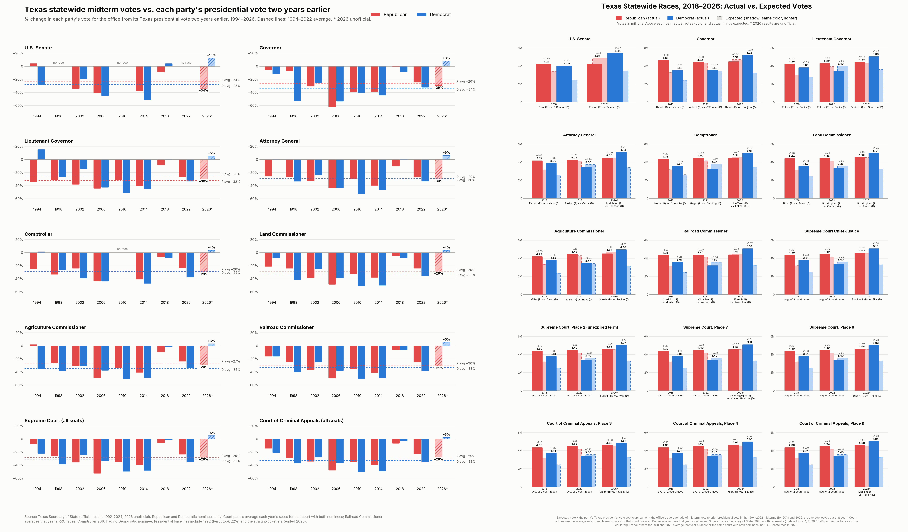
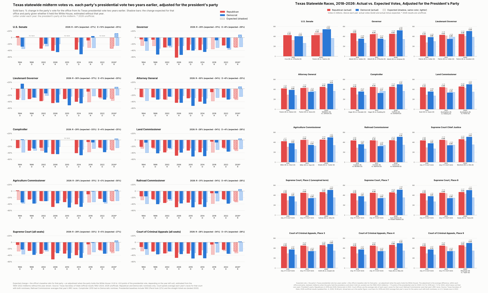

# Texas 2026 statewide races: actual vs. expected votes

Two figures that compare each party's 2026 vote for every Texas statewide office with the vote that party would have
been expected to get if 2026 had followed the 1994–2022 midterm pattern. The data, the code and every intermediate
file are in this repository; each source can be downloaded again from the Texas Secretary of State (SOS) and checked
against the copy here.

**2026 results are unofficial.** They are the SOS count last updated **Nov. 4, 2026, 10:48 pm** (Central time), with
all 254 counties reporting. The state canvass will replace them; see [Updating after the canvass](#updating-after-the-canvass).

## The two figures

### 1. `figures/texas_history_and_expected.png`



- **Left:** for each statewide office, each party's midterm vote as a % change from that party's Texas presidential
  vote two years earlier, for every midterm from 1994 to 2026. The dashed lines are the 1994–2022 averages. The 2026
  bars are hatched because the count is unofficial.
- **Right:** the 15 statewide races on the 2026 ballot. For 2018, 2022 and 2026 each panel shows the actual Republican
  and Democratic votes (solid bars). Behind each is a lighter "shadow" bar: the vote expected from the party's
  presidential vote two years earlier × the office's average midterm ratio. Above each pair are the actual votes (bold,
  millions) and actual minus expected.

### 2. `figures/texas_incumbency_history_and_expected.png`



This is the same comparison, but the expectation also accounts for which party holds the White House. In Texas, as
nationally in House races, the president's party usually loses more of its presidential vote at the midterm.

- **Left:** the solid bars are the actual % change, as in figure 1. The shadow bars are the change expected for that
  office, party and year given the president's party, estimated without the year shown. The letter under each year is
  the president's party.
- **Right:** as in figure 1, with the president's-party expectation as the shadow bar.

The four single figures that make up the two images are in `figures/panels/`.

## What the figures show

Actual minus expected votes, in millions, as the range across the races on the 2026 ballot. Every race and year is
listed in [RESULTS.md](RESULTS.md).

| Expectation | Year | Races | Republican | Democrat |
|---|---|---:|---:|---:|
| plain | 2018 | 15 | +0.85 to +1.36 | +0.95 to +1.57 |
| plain | 2022 | 14 | +0.09 to +0.38 | −0.56 to +0.07 |
| plain | 2026* | 15 | −0.64 to +0.14 | +1.46 to +2.02 |
| president's party | 2018 | 15 | +1.04 to +1.64 | +0.73 to +1.41 |
| president's party | 2022 | 14 | −0.09 to +0.20 | −0.37 to +0.23 |
| president's party | 2026* | 15 | −0.45 to +0.44 | +1.23 to +1.82 |

\* unofficial. 2022 had no U.S. Senate race.

Read plainly:

- **2018:** both parties got more votes than expected in every race, under either expectation.
- **2022:** with the plain expectation, Republican nominees were 0.09M–0.38M above expected. Democratic nominees ranged
  from 0.56M below to 0.07M above.
- **2026:** with the plain expectation, Republican nominees ranged from 0.64M below expected (U.S. Senate) to 0.14M
  above. Democratic nominees were 1.46M–2.02M above expected. With the president's-party adjustment, Republicans
  ranged from 0.45M below to 0.44M above, and Democrats were 1.23M–1.82M above.

The president's-party adjustment is −7.5 points of the presidential vote for 2026. Depending on which year is left
out, it ranges from −6.8 to −8.8.

These figures measure how far each party's vote was from the historical pattern. They do not say why. Turnout among
new and returning voters, voters switching parties, and changes in who is registered can all produce the same totals.
Telling them apart needs voter-level and precinct-level data that these statewide totals do not contain.

## Method in brief

The full method is in [METHODOLOGY.md](METHODOLOGY.md).

- **Ratio.** For office *o*, party *p* and midterm year *y*: ratio = the party's nominee vote for the office in *y* ÷
  the party's presidential nominee vote in Texas in *y* − 2. Only Republican and Democratic nominees are counted, and
  only races with exactly one of each.
- **Plain expectation.** The presidential vote two years earlier × the office's average ratio over the 1994–2022
  midterms, leaving out the year being estimated.
- **President's-party expectation.** The ratio is modeled as *a*[office, party] + *b* × (party holds the White House).
  *b* is one slope pooled across offices and parties. Both *a* and *b* are estimated from 1994–2022 without the year
  being estimated.
- **Courts.** Supreme Court and Court of Criminal Appeals seats have six-year staggered terms, so the same seat was not
  on the 2018 or 2022 ballot. Those years use the average of that court's races with both nominees, and the
  expectation for a court is court-wide. Railroad Commissioner averages that year's Railroad Commission races.

## Data sources

All data comes from the Texas Secretary of State. [`data/SOURCES.csv`](data/SOURCES.csv) lists every file with its
URL, download time (UTC), size and sha256.

| Years | What | Where it comes from | Files here |
|---|---|---|---|
| 1992–2018 general elections | Official canvass, "Race Summary Report", one page per election | `https://elections.sos.state.tx.us/elchist<id>_state.htm`, ids 5 (1992), 11, 56, 72, 82, 95, 114, 127, 141, 154, 164, 175, 319, 331 (2018); index at https://elections.sos.state.tx.us/index.htm | `data/raw/sos_elchist_1992_2018/` |
| 2020, 2022, 2024 general elections | Final results, JSON behind https://results.texas-election.com | `https://results.texas-election.com/static/data/election/<election id>/<version>/{StateWide,Federal}.json`; election ids 44144 (2020), 47009 (2022), 49664 (2024) are listed in `ElectionConstants_<version>.json`, named by `static/data/Version.json` | `data/raw/sos_results_2020_2024/` |
| 2026 general election | Unofficial results, JSON behind https://goelect.txelections.civixapps.com/ivis-enr-ui/races | `https://goelect.txelections.civixapps.com/api-ivis-system/api/s3/enr/election/53815` (fields are base64 JSON); election ids in `.../api/s3/enr/electionConstants` | `data/raw/sos_enr_2026/` |

Both JSON sites answer HTTP 403 to requests that lack a browser-style User-Agent. `src/fetch_sources.py` sends one.

The presidential baselines come from the same files: 1992–2016 from the Race Summary Reports, and 2020 and 2024 from
`Federal.json`.

## Reproduce

Requirements: Python 3.10 or newer, matplotlib and Pillow. The published figures were made with Python 3.14.4,
matplotlib 3.10.7 and Pillow 12.1.1, using the Inter font. Without Inter, matplotlib falls back to Noto Sans or DejaVu
Sans and the images differ slightly, but the numbers do not.

```bash
./build.sh                          # rebuild everything from data/raw/ into build/ and compare with the committed files
./build.sh out --strict             # also require the figures to match byte for byte
python3 src/fetch_sources.py new/   # download every source again into new/ and check it against data/raw/
```

`build.sh` runs these steps:

| Step | Script | Output |
|---|---|---|
| Parse the 1992–2018 pages (table rows) | `src/parse_elchist.py` | `data/intermediate/elchist_parsed.json` |
| Parse the 2018 page (text layout) | `src/parse_2018.py` | `data/intermediate/tx2018_races.json` |
| Decode the 2026 file | `src/decode_2026.py` | `data/intermediate/tx2026_{StateWide,Federal}.json` |
| Actual R/D votes for the 15 races, 2018/2022/2026 | `src/build_races_csv.py` | `data/derived/texas_statewide_2018_2022_2026.csv` |
| Ratios, averages and expected votes, 1994–2026 | `src/expected_midterm.py` | `data/derived/texas_midterm_vs_presidential.csv` |
| The four single figures | `src/expected_figs.py` | `figures/panels/*.png` |
| The two combined images | `src/splice.py` | `figures/*.png` |
| Tables of every number | `src/results_table.py` | `RESULTS.md` |
| Comparison with the committed files | `src/verify.py` | pass/fail per file |

`data/SHA256SUMS` holds the sha256 of every committed file (`sha256sum -c data/SHA256SUMS` from the repository root).

### Column guide for `data/derived/texas_midterm_vs_presidential.csv`

| Column | Meaning |
|---|---|
| `office`, `title`, `year` | office key, display name, midterm year |
| `n_races` | number of races averaged (courts, Railroad Commission; 1 otherwise) |
| `pres_rep`, `pres_dem` | party's Texas presidential vote two years earlier |
| `rep`, `dem` | party's vote for the office (average over `n_races`) |
| `ratio_rep`, `ratio_dem` | `rep / pres_rep`, `dem / pres_dem` |
| `n_hist` | number of 1994–2022 midterms in the average (own year left out) |
| `avg_ratio_*`, `expected_*`, `dev_*` | plain expectation: average ratio, expected vote, actual − expected |
| `inc_b` | president's-party slope *b* for this year (fraction of the presidential vote) |
| `expected_inc_*`, `dev_inc_*` | president's-party expectation: expected vote, actual − expected |

## Updating after the canvass

1. Download the new 2026 file into `data/raw/sos_enr_2026/election_53815.json`. `src/fetch_sources.py` does this and
   prints the new `LastUpdatedTime`.
2. Update its row in `data/SOURCES.csv` (time, size, sha256) and the `ASOF` line in `build.sh`.
3. Run `./build.sh build`, then copy `build/intermediate`, `build/derived`, `build/figures` and `build/RESULTS.md`
   over the committed copies.
4. Regenerate `data/SHA256SUMS` and commit.

## Limitations

- **2026 is unofficial.** Late mail ballots, provisional ballots and canvass corrections will change the totals
  slightly.
- **Few data points.** Each office has at most eight earlier midterms. The president's-party slope comes from five
  midterms under a Democratic president (1994, 1998, 2010, 2014, 2022) and three under a Republican one (2002, 2006,
  2018).
- **The presidential baseline moves.** Third-party presidential votes vary; Ross Perot took 22% in 1992, which lowers
  both 1994 baselines.
- **Straight-ticket voting ended in 2020.** House Bill 25 (2017) eliminated it effective Sept. 1, 2020
  ([SOS Election Advisory 2020-29](https://www.sos.state.tx.us/elections/laws/advisory2020-29.shtml)). It was
  available in every election through 2018, so the 2022 and 2026 down-ballot votes were cast under different rules
  than the 1994–2018 history they are compared with.
- **Courts and the Railroad Commission compare averages, not the same seat.**
- **Third-party and write-in votes are excluded.**
- **Each party is measured against its own baseline.** A larger deviation for one party does not translate one for one
  into margin.
